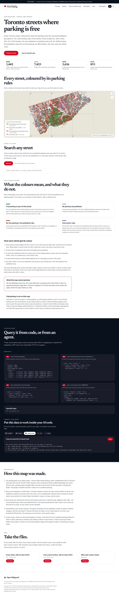
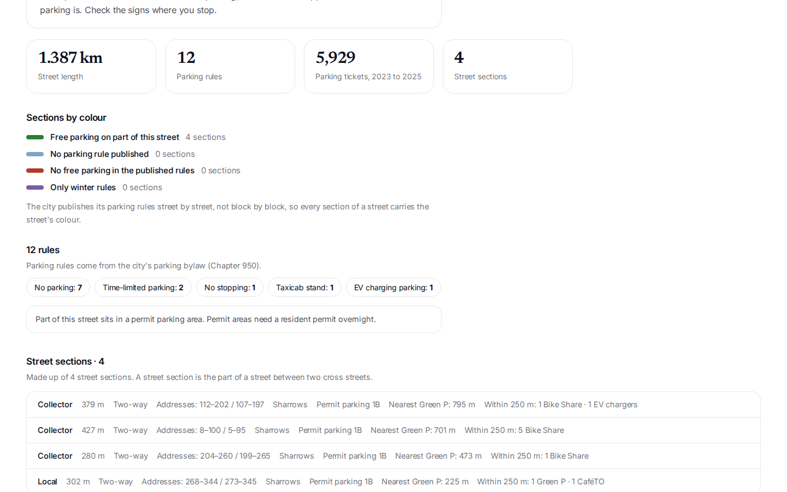
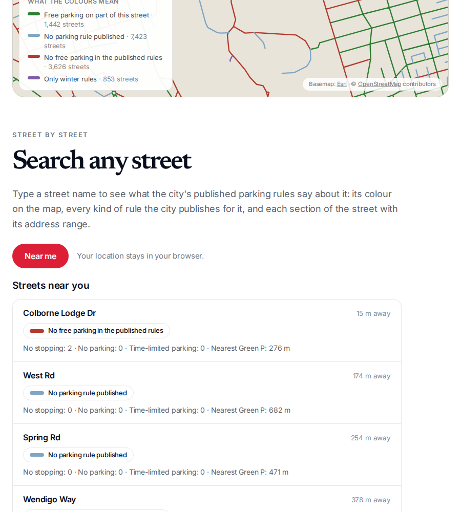
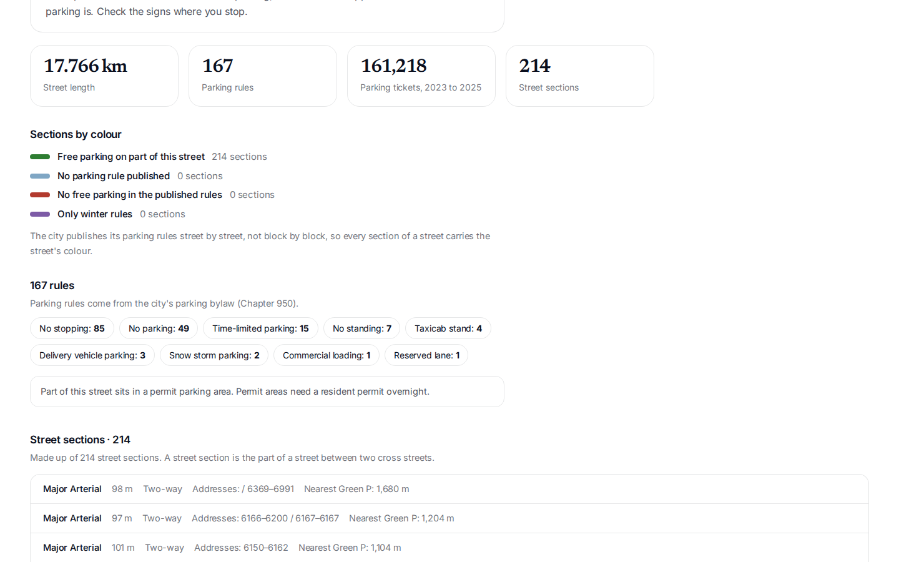
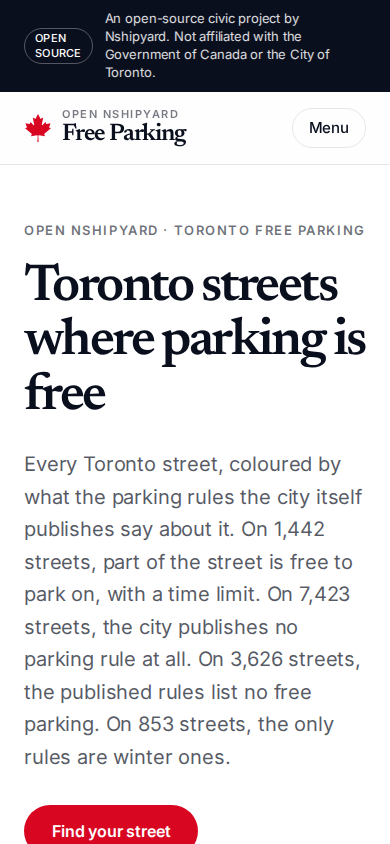

# Toronto Free Parking

**Toronto streets where parking is free.** Every Toronto street, coloured by
what the parking rules the city itself publishes say about it. On 1,442
streets, part of the street is free to park on, with a time limit. On 7,423
streets, the city publishes no parking rule at all. On 3,626 streets, the
published rules list no free parking. On 853 streets, the only rules are
winter ones.

Live site: https://toronto-free-parking.vercel.app

Part of [Open Nshipyard](https://canada.nshipyard.com). A citizen tool,
map first: the homepage is the map, with a Near me button, street search,
and the classified data as downloads.

## The four classes

Every street gets exactly one class, from the kinds of its published
parking rules (City of Toronto parking bylaw, Chapter 950, current rules).
Presence decides, never a comparison of counts: how many rules of a kind a
street has is an artifact of how the bylaw is written, so a street with one
time-limited parking rule and ten ban rules still has free parking on part
of it. The tests run in this order, and the first that matches wins:

1. **No parking rule published** (`norule`): the street has no published
   rules at all. 7,423 streets, 15,325 sections.
2. **Only winter rules** (`winter`): the street has published rules but no
   bans and no time-limited parking. Its only rules are winter or snow
   rules, or a special use such as a school bus loading zone or a taxi
   stand. 853 streets, 1,749 sections. On all but 3 of these, the only
   rules are winter or snow rules.
3. **Free parking on part of this street** (`free`): the city publishes
   time-limited parking for part of this street, so part of it is free to
   park on. Other parts of the same street can be no parking, and a time
   limit applies where the free parking is. Check the signs where you
   stop. 1,442 streets, 15,427 sections.
4. **No free parking in the published rules** (`nofree`): every parking
   rule the city publishes for this street is a ban: no parking, no
   stopping, or no standing. The published rules list no free parking on
   this street. 3,626 streets, 17,526 sections.

The four classes cover all 13,344 streets and 50,027 sections.

> **Classification change, 2026-10-20.** The first version compared rule
> counts: a street was "Free, time limit applies" only when its
> time-limited rules were at least as many as its bans, and "No parking"
> when bans outnumbered them. That labelled streets like High Park Ave "No
> parking" even though part of the street has free time-limited parking.
> The classification is now presence-based, as above. In the API, the
> class key `noparking` was renamed `nofree`, and the `free` class now
> covers every street with at least one time-limited parking rule.

### Why there is no paid class

Paid parking is not in the data. The Chapter 950 schedules the city
publishes as open data contain no paid or metered parking category: a text
search of all 27,768 current rules finds no pay-and-display, parking
machine, or metered schedule. The only Green P source lists off-street car
parks (garages and lots), not on-street spaces. Paid status therefore
cannot be read street by street, no class was invented for it, and the
site says so on its face: a street in a free colour can still have paid
machines on it.

### The honesty note (printed on the site)

> No rule published means the city's open data lists no parking rule for
> that street. It does not guarantee parking is legal there. Toronto's
> unsigned 3-hour limit and winter snow routes still apply. Check the
> signs where you stop.

## Methodology

- The starting point is the sister project
  [Toronto Open Street Parking](https://github.com/Nshipyard/toronto-open-street-parking),
  which combined the City of Toronto's open data into one file of 50,027
  street sections, each carrying its street's published parking rule
  counts. This project classifies that file; it does not re-combine
  anything. `scripts/build_data.py` reads the sister project's outputs
  and emits every data file this site serves.
- Rule counts are street-level. The bylaw names a street, a side, and a
  stretch in words, and publishes locations for almost none of its rules,
  so the combined file matched rules to streets by street name (86.6% of
  rules matched). Every section of a street shares the street's counts,
  its class, and its colour. The per-section CSV therefore carries the
  street's class on each section.
- Ticket counts (2023 to 2025) come from the city's published parking
  tickets, matched to streets by the address on each ticket. They are
  shown on street pages for context only; they played no part in choosing
  any street's colour.
- The map geometry is the sister project's simplified per-street shape
  file (one shape per street, 13,344 streets) with the class added per
  street. Basemap tiles are Esri World Street Map (keyless), drawn under
  a hand-rolled SVG overlay in the browser.

## Data files

| File | Rows | Contents |
| --- | --- | --- |
| `public/data/free_parking_streets.csv` | 13,344 | One row per street: class, sections, length, rule counts by kind, tickets, permit and bike shares |
| `public/data/free_parking_sections.csv` | 50,027 | One row per street section: street, class, road class, length, address ranges, permit area, nearest Green P |
| `data/data_dictionary.md` | | What each column means |
| `public/data/streets_map.geojson` | 13,344 features | Simplified street shapes with the class as a property |
| `data/app_data.json` | | Summary + street rollup read by the API |
| `data/segments_by_street.json` | 13,344 streets | Per-street sections and rule counts by kind (copied from the sister project) |

## API

- `GET /api/v1/parking/summary` — streets, sections, and counts per class.
- `GET /api/v1/parking/streets?q=yonge&class=nofree&limit=50` — search
  streets by name and/or class.
- `GET /api/v1/parking/streets/YONGE%20ST` — one street in full: class,
  rules by kind, and every section.
- `GET /api/openapi.json` — OpenAPI 3.1 spec.
- `POST /mcp` — MCP server (streamable HTTP) with tools `parking_summary`,
  `parking_search_streets`, and `parking_street_profile`.

## Development

```bash
npm install
npm run dev        # http://localhost:3000
npm run build && npm start
python3 scripts/build_data.py   # regenerate data/ and public/data/ outputs
python3 scripts/screenshot.py   # capture docs/screenshots (needs a running server)
```

English and French throughout (toggle in the header). Next.js 16, React
19, Tailwind 4. No API keys; the map tiles are keyless Esri tiles.

## Screenshots







Screenshot note: the sandbox browser cannot load the external basemap
tiles, so the captures show the coloured streets on a blank background.
The live site draws the streets over the Esri basemap.

## Licence

MIT for the code and the classified files. Source data remains the City of
Toronto's, under the Open Government Licence, Toronto.
